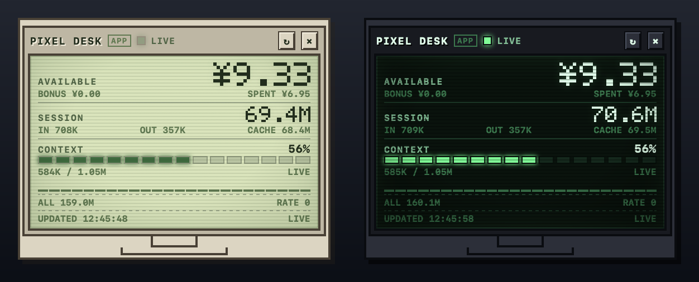

# Pixel Usage Desk — macOS desktop app

A standalone Swift + WKWebView widget with the same pixel CRT look as the DSH plugin. It is transparent, borderless, draggable from the top border, and has a Dock icon so it is always findable.



## Build and run

Requirements: macOS 13+, Xcode Command Line Tools (`swiftc`).

```bash
./build.sh
open PixelUsageDesk.app
```

If the app is already running, macOS activates the existing instance. To rebuild after changing `main.swift` or `desk.html`:

```bash
./build.sh
open PixelUsageDesk.app
```

The `Start Pixel Usage Desk.command` file is a Finder fallback for machines where LaunchServices refuses to open the ad-hoc-signed app.

## Controls

- **Move**: drag anywhere on the **top border** (full width).
- **Hide**: the `×` button only hides the window. Reopen from the Dock icon (Pixel Usage Desk) or the menu-bar display icon.
- **Refresh**: `↻` in the header, or the menu-bar `立即刷新`.
- **Appearance**: menu-bar display icon → `外观` → `跟随系统` / `浅色` / `深色`.
- **Float / desktop**: menu-bar `悬浮在所有窗口上方`. Uncheck it to keep the widget in the normal desktop window layer (it will be covered by app windows; press F11 / Show Desktop to see it).
- **Reset**: menu-bar `重置位置（右上角）`.
- **Quit**: menu-bar `退出 Pixel Usage Desk`; the Dock icon disappears.

## Data

- Balance: `~/.dsh/.credentials.yaml` token → `https://platform.deepseek.com/api/v0/users/get_user_summary`. The token is read-only and never written.
- Usage: `~/.dsh/storages/session_projcache/sessions/*.json` (`tokenUsage` and `contextPressure` projections). The current session is the most recently modified cache file.
- Refresh: balance every 30 s, usage every 2 s.
- If DSH is signed out, the widget shows `NO ACCOUNT`; token usage still comes from the last available cache.

## Optional: start at login

The app has no installer. To start it at login, create a LaunchAgent:

```bash
mkdir -p ~/Library/LaunchAgents
cat > ~/Library/LaunchAgents/local.pixelusagedesk.plist <<'PLIST'
<?xml version="1.0" encoding="UTF-8"?>
<!DOCTYPE plist PUBLIC "-//Apple//DTD PLIST 1.0//EN" "http://www.apple.com/DTDs/PropertyList-1.0.dtd">
<plist version="1.0">
<dict>
  <key>Label</key><string>local.pixelusagedesk</string>
  <key>ProgramArguments</key>
  <array><string>/Applications/PixelUsageDesk.app/Contents/MacOS/PixelUsageDesk</string></array>
  <key>RunAtLoad</key><true/>
  <key>KeepAlive</key><dict><key>SuccessfulExit</key><false/></dict>
  <key>LimitLoadToSessionType</key><string>Aqua</string>
</dict>
</plist>
PLIST
```

Adjust the path in `ProgramArguments` to where you put the app, then:

```bash
launchctl bootstrap gui/$(id -u) ~/Library/LaunchAgents/local.pixelusagedesk.plist
```

## License

MIT.
